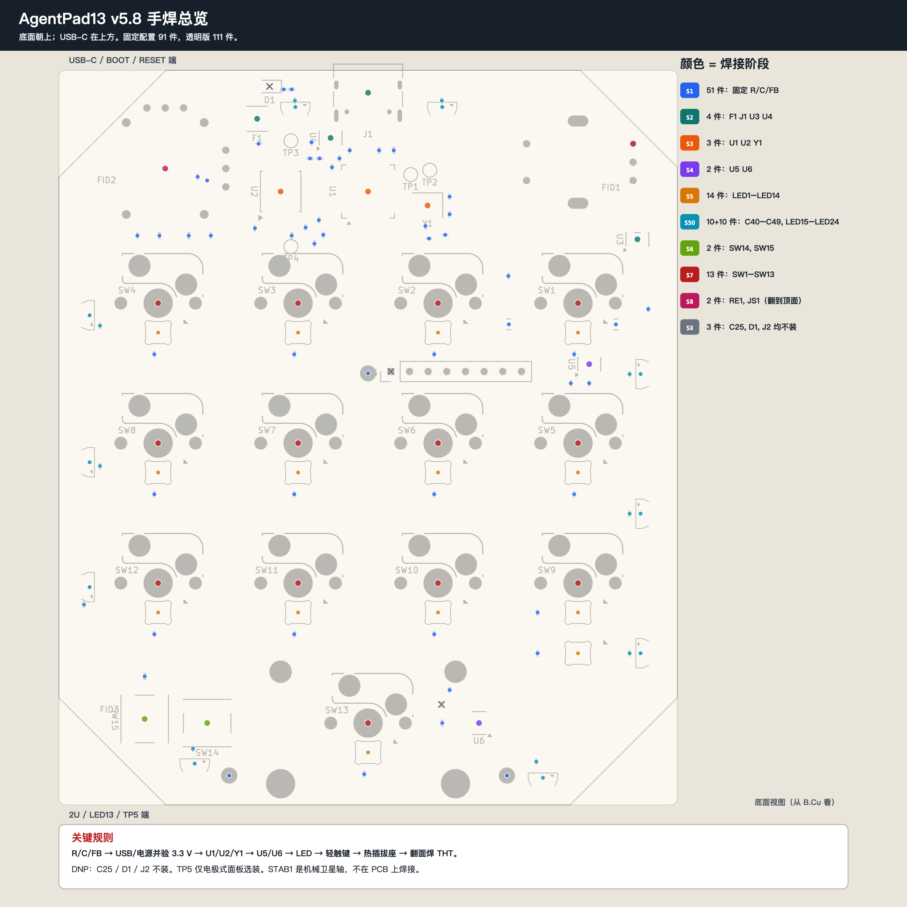
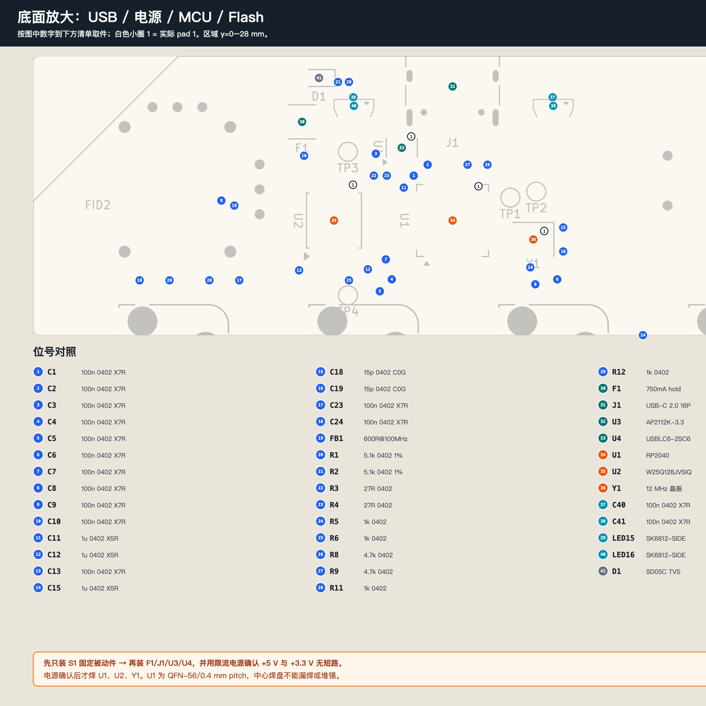
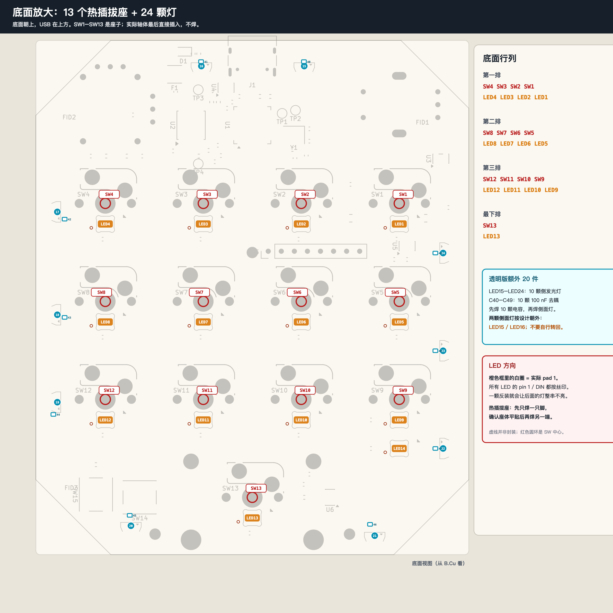
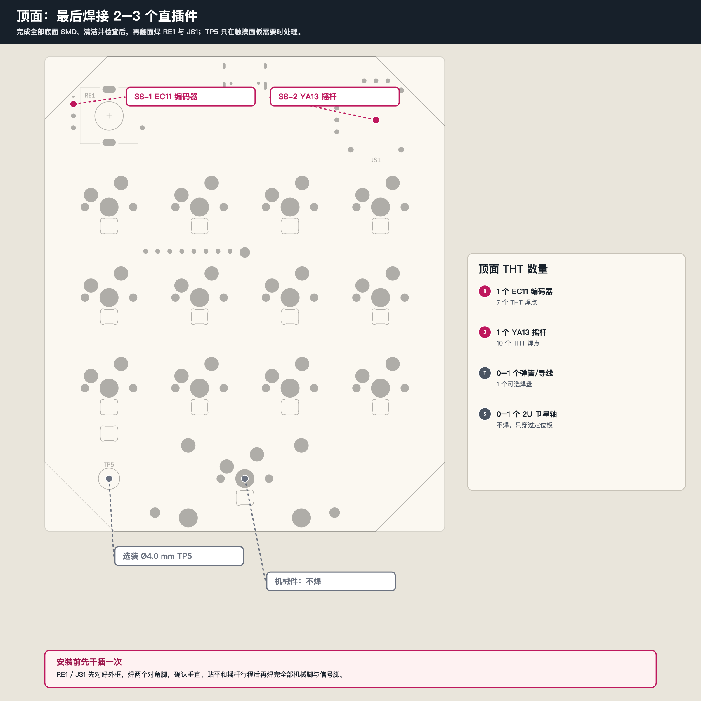

# AgentPad13 v5.8 透明版手焊指南

适用于本仓库当前公开板 `release/hardware/pcb/v5_8.kicad_pcb`，并假定订购的是**裸 PCB**。
开始前先看板上丝印和板框：如果实物不是 v5.8，不要直接套用本页坐标与封装方向。

网页版入口：[`index.html`](index.html)。页面只保留透明版全装路线，拆成 28 个单型号步骤；
每一步只出现一种元件型号，并配一张高亮图，支持步骤勾选、全屏看图、元件值核对和 116 行位号筛选。

这块板没有“Pico 小板”：`U1` 是直接焊在 PCB 上的裸 RP2040，QFN-56、0.4 mm pitch，
必须有锡膏和热风，单靠普通烙铁逐脚焊风险很高。

## 先看结论

| 项目 | 透明版全装 |
| --- | ---: |
| 需要手焊的 PCB 元件 | **111 个** |
| 单型号焊接步骤 | **28 步** |
| 默认禁止安装 | C25、D1、J2，共 3 个 |
| 侧发光固定件 | C40-C49、LED15-LED24，共 20 个 |
| 顶面直插件 | RE1、JS1，共 2 个 |
| 选装触摸触点 | TP5_CONTACT，0-1 个 |
| 实际 MX 轴体 | 13 个，不焊 |

`SW1-SW13` 是焊在 PCB 上的 **MX 热插拔座**。真正的 MX 轴体最后直接插入座子。
`STAB1` 是 2U 定位板卫星轴，PCB 上只有让位孔，不需要焊接。

## 标注图

- 单型号步骤图：`step-01.zh-CN.png` 到 `step-28.zh-CN.png`
- [逐位号坐标与焊接检查表](agentpad13-v5_8-placement-checklist.zh-CN.csv)

所有底面图都以“**板子翻到 B.Cu 朝上，USB-C 在远端/上方**”为观察方向。图上左右与顶面视图相反，
这是正常的；焊座子和灯时按图上的 `SW1`、`LED1` 等实际位号找，不要只按行列猜。

## 元件预分装

先把同封装不同值分开，尤其是下面几组。否则手焊时最容易发生“位置对了，值装错”。

| 袋子/格 | 数量 | 值或型号 | 参考位号 |
| --- | ---: | --- | --- |
| C-100n-fixed | 30 | 100 nF 0402 X7R | C1-C10、C13、C20-C24、C26-C39 |
| C-1u | 4 | 1 uF 0402 X5R | C11、C12、C14、C15 |
| C-10u | 2 | 10 uF 0805 X5R | C16、C17 |
| C-15p | 2 | 15 pF 0402 C0G | C18、C19 |
| R-5k1 | 2 | 5.1 k 0402 | R1、R2 |
| R-27R | 2 | 27 ohm 0402 | R3、R4 |
| R-1k | 4 | 1 k 0402 | R5、R6、R11、R12 |
| R-10k | 1 | 10 k 0402 | R7 |
| R-4k7 | 2 | 4.7 k 0402 | R8、R9 |
| R-0R | 1 | 0 ohm 0402 | R10 |
| FB1 | 1 | 600 ohm @ 100 MHz 0402 | FB1；外形像电阻，不要混入 R |
| LED-key | 14 | SK6812MINI-E | LED1-LED14 |
| LED-edge | 10 | SK6812-SIDE | LED15-LED24，仅透明版 |
| C-edge | 10 | 100 nF 0402 | C40-C49，仅透明版 |
| Sockets | 13 | Kailh CPG151101S11 | SW1-SW13 |
| Tact | 2 | C&K PTS645SM43SMTR92 LFS | SW14=BOOT，SW15=RESET |
| IC / connector | 9 | 见 CSV | U1-U6、Y1、F1、J1 |
| Top THT | 2 | EC11、YA13 | RE1、JS1 |

**不要安装：** C25、D1、J2。`C25` 是触摸灵敏度调校位；`D1` 是预留 TVS，本版已有 U4
`USBLC6-2SC6`；`J2` 是预留 1x08 扩展排针位。

`FID1-FID3` 是贴片机光学基准点，`TP1-TP5` 是测试/触摸焊盘，都不属于 BOM 元件。
除需要外接触摸电极的 `TP5` 外，其余测试点和基准点保持裸焊盘即可。

## 设备和耗材

- 恒温烙铁：尖头/刀头各一，建议 300-330 °C；无铅工艺可到 340 °C，但每次停留尽量短。
- 热风枪：建议 300-350 °C、低风速；`U1`、`J1` 优先用锡膏回流。
- 锡膏、0.3-0.5 mm 免清洗焊锡丝、助焊剂、吸锡带、异丙醇、无绒棉签。
- 尖嘴镊子、放大镜或显微镜、耐高温胶带、硅胶垫。
- 最好有可调限流电源；第一次上电不要直接接电脑 USB。

不要用热风近距离猛吹 0402 和反装 LED；它们会被吹飞。焊接 QFN 时也不要一次堆大量锡膏，
否则 `U1` 的 0.4 mm 脚间会连锡。

## 推荐焊接顺序

网页中的 28 个单型号步骤是逐型号执行顺序。下面的文字按工艺组概述，便于快速总览。

### 1. 裸板检查

1. 用放大镜和万用表检查所有焊盘是否覆盖阻焊、USB 焊盘是否完整、LED 开窗是否贯通。
2. 检查板面没有锡渣或铜屑。不要先给全部焊盘预上厚锡。
3. 在 USB 座、QFN、SOIC 和 LED 附近先拍一张高清空板照片，方便装错后对照。
4. 保持底面朝上。以下 SMD 步骤全部先在底面完成。

### 2. S1：底层固定 R/C/FB，51 个

先焊最低、最小的固定被动件：

1. 2 个 10 uF 0805：`C16`、`C17`。
2. 30 个 100 nF 0402：`C1-C10`、`C13`、`C20-C24`、`C26-C39`。
3. 4 个 1 uF 0402：`C11`、`C12`、`C14`、`C15`。
4. 2 个 15 pF 0402：`C18`、`C19`。不要用普通 100 nF 替代。
5. 12 个电阻：`R1-R12`，按预分装袋逐一核对阻值。
6. 1 个磁珠：`FB1`，600 ohm @ 100 MHz。

每个 0402 的做法：给一个焊盘上少量锡，镊子夹住元件放平，先焊一端，确认没有立碑和偏移，
再焊另一端。不要在一个焊盘上反复长时间加热。

**本步完成前不要装 C40-C49；这 10 个是透明版额外件，稍后再装。**

### 3. S2：USB 与电源入口，4 个

依次焊接：

1. `U3` AP2112K-3.3，SOT-23-5。对齐 pin 1。
2. `U4` USBLC6-2SC6，SOT-23-6。对齐 pin 1。
3. `F1` 750 mA 自恢复保险丝，1812。无极性，但必须完全贴平。
4. 最后焊 `J1` USB-C 16P。USB 座较高，最后装便于前面小件保持板面平整。

`J1` 用锡膏和热风更容易。两端壳脚先固定，确认插头开口和板边关系正确，再逐个焊信号脚。
USB-C 的脚距小，焊完必须放大检查 D+/D- 和 VBUS 是否连锡。

#### S2 后的强制检查点

此时**不要装 U1 和 U2**。先只给 USB 输入供电，使用限流电源，建议从 100 mA 限额起步：

1. 测量 VBUS 对 GND 没有短路。
2. 测量 `U3` 输出对 GND 为约 3.3 V。
3. 若 3.3 V 过高、为零或输入电流异常，停止。先查 `U3` 方向、USB 连锡和电源电容。
4. 确认 3.3 V 正常后断电，再继续焊主控。

这一步可以避免电源故障直接损坏 RP2040 和 Flash。

### 4. S3：MCU、Flash、晶振，3 个

1. `U1` RP2040，QFN-56，0.4 mm pitch。必须对齐 pin 1，中心散热焊盘也要有适量锡膏。
2. `U2` W25Q128JVSIQ，SOIC-8。对齐 pin 1。
3. `Y1` 12 MHz，4 脚 3225 晶振。按丝印方向放正；`C18`、`C19` 已在附近。

`U1` 推荐做法：焊盘薄薄涂锡膏，中心焊盘不要厚；放正后低风速热风回流。芯片能自行回位后，
停止移动，冷却后用助焊剂和吸锡带清理脚间连锡。不要用烙铁强推芯片。

主控焊完后先不接 USB，检查：

- 3.3 V 对 GND 无短路。
- U1 四边每个脚与相邻脚无连锡。
- U1 pin 1、U2 pin 1、Y1 方向与图一致。

### 5. S4：灯控与触摸 IC，2 个

1. `U5` SN74LVC1T45，SOT-23-6，负责 LED 数据电平转换。
2. `U6` TTP223-BA6，SOT-23-6，负责触摸。

两者都要对齐 pin 1。`R10=0 ohm` 已经属于 S1，作用是把触摸控制配置为高有效；不要漏装。

### 6. S5：侧灯去耦 C40-C49，10 个

透明版固定安装 10 颗 `100 nF 0402`。先完成 C40-C49，再进入侧灯步骤。

### 7. S6：LED1-LED14，14 个

先把 14 个反装 `SK6812MINI-E` 全部按位号放好：

- 第一排：`LED1-LED4`
- 第二排：`LED5-LED8`
- 第三排：`LED9-LED12`
- 最下排：`LED13`
- 左侧独立指示位：`LED14`

每个 LED 的 pin 1 / DIN 标记必须和丝印一致。建议一次只焊一颗，先固定对角两点，再焊另外两点。
所有 LED 都装完后先目检，再上电；一颗反装可能让后续整串都不亮。

### 8. S7：侧边 LED15-LED24，10 个

1. 上边焊 `LED15`、`LED16`，右边焊 `LED17-LED19`。
2. 下边焊 `LED20`、`LED21`，左边焊 `LED22-LED24`。
3. `LED15`、`LED16` 按当前 v5.8 设计故意朝外；其余按封装方向安装。

### 9. S8：BOOT / RESET，2 个

1. `SW14`：BOOT。
2. `SW15`：RESET。

型号是 C&K `PTS645SM43SMTR92 LFS`，6.0 x 6.0 mm、H4.3、鸥翼脚。
不要装成 `PTS645SM43JSMTR92 LFS` 的 J 引脚版本。四脚没有极性，先对角固定，再焊另外两脚。

### 10. S9：热插拔座 SW1-SW13，13 个

这是底面最后一批 SMD。因为座体高、热容量大，早装会让板子不平，也可能挡住后续热风。

顺序建议：`SW4 → SW3 → SW2 → SW1 → SW8 → SW7 → SW6 → SW5 → SW12 → SW11 → SW10 → SW9 → SW13`。
这是从底面左上按排推进的顺序，不改变任何电气连接。

每个座子：

1. 先按丝印确认朝向；本板 CPL 为 180°。
2. 先焊一端，确认座体平贴、中心孔不与相邻元件干涉。
3. 再焊另一端。不要先把一整排全部焊死再回头纠偏。
4. 座子里不要进锡，不要用实际 MX 轴体当夹具在高温时强插。

### 11. S10：翻面焊顶面 THT

底面全部完成、清洁并检查后，再翻到顶面：

1. 干插 `JS1` YA13 摇杆，确认 10 个脚都能无应力进入。
2. 干插 `RE1` EC11 编码器，确认 7 个焊点都能进入。
3. 先焊每个器件两个对角脚，检查垂直、贴平和方向，再焊完所有信号脚与机械脚。
4. 编码器轴应垂直于板；摇杆应能完整活动且不被相邻结构干涉。
5. `TP5` 只有使用带电极的触摸定位板时才焊弹簧/导线。普通打印板或空白 FR4 板留空。

不要把 `STAB1` 当 PCB 元件焊：它是 2U 定位板卫星轴，只安装到定位板/键帽系统。

## 完成后的检查

### 不通电检查

- 5 V、3.3 V 对 GND 都没有接近 0 ohm 的短路。
- 所有 IC 的 pin 1 与图上方向一致。
- 所有 LED 的 pin 1 / DIN 方向一致。
- USB-C、U1、U2、Y1 附近没有连锡。
- C25、D1、J2 没有误装；透明版的 C40-C49、LED15-LED24 必须全部安装。
- SW1-SW13 没有装反，热插拔座内没有锡珠。

### 首次上电

1. 用限流电源或 USB 电流表上电，发现大电流、发热或异味立即断开。
2. 确认 3.3 V 稳定后，再连接电脑。
3. 按住 `SW14` BOOT，再插 USB，RP2040 应出现为 `RPI-RP2` 盘。
4. 刷写 `firmware/prebuilt/agentpad13.uf2`。
5. 先确认 USB 枚举，再逐个测 13 个轴位、编码器按压/旋转、触摸和摇杆。
6. 首次使用摇杆前按 `firmware/BRING-UP.md` 完成一次板上校准。

## 常见故障的优先检查点

| 现象 | 先查 |
| --- | --- |
| 无 3.3 V | F1、J1 VBUS、U3 方向、C14-C17、U3 输出连锡 |
| 插入 USB 大电流 | U3/U4 方向、VBUS-GND、U1 脚间连锡 |
| 不出现 RPI-RP2 | U1 pin 1、U1 中心焊盘、Y1、U2 pin 1、3.3 V |
| 某一行按键异常 | 对应 SW 座、LED 附近 100 nF、矩阵焊点 |
| 一颗灯不亮，后面全不亮 | 该灯 pin 1/DIN、DOUT、四脚是否虚焊 |
| 触摸一直触发或完全不触发 | `R10=0 ohm`、U6 pin 1、TP5、固件是否为当前版本 |
| 编码器方向反 | 先更新当前固件；v5.8 固件已按实板方向处理 |
| 摇杆方向反或行程不足 | 先按 BRING-UP 校准；方向反再看 `firmware/POLARITY-NOTE.md` |

## 来源

- `release/hardware/pcb/v5_8.kicad_pcb`
- `release/hardware/pcb/fabpack_out_v5_8/assembly/bom_opaque.csv`
- `release/hardware/pcb/fabpack_out_v5_8/assembly/bom_translucent.csv`
- `release/hardware/pcb/fabpack_out_v5_8/assembly/cpl_opaque.csv`
- `release/hardware/pcb/fabpack_out_v5_8/assembly/cpl_translucent.csv`
- `release/hardware/pcb/V5-NOTES.md`
- `release/HOW-TO-ORDER.md`
- `release/RELEASE.md`
